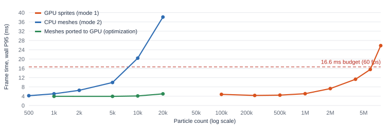

# Scaling sweep

Generated by `Tools/SummarizeSweep.py` from `Tools/Sweep.ps1` captures (lab sandbox, 1080p, auto-moving attractor). All times in ms, means over the capture window unless noted; P95 excludes the three flagged screenshot frames. Budget = wall P95 <= 16.6 ms and Niagara GT+RT <= 4 ms.

## Baseline (no particles)

| Count | Wall mean | Wall P95 | Game thread | Render thread | GPU frame | Niagara GT+RT | Niagara GPU sim | Budget |
|---:|---:|---:|---:|---:|---:|---:|---:|:---:|
| 0 | 2.43 | 3.27 | 2.20 | 2.40 | 1.56 | 0.000 | — | pass |

## System 1: GPU sprites (mode 1)

| Count | Wall mean | Wall P95 | Game thread | Render thread | GPU frame | Niagara GT+RT | Niagara GPU sim | Budget |
|---:|---:|---:|---:|---:|---:|---:|---:|:---:|
| 100,000 | 3.79 | 4.78 | 3.43 | 3.78 | 2.11 | 0.135 | 0.055 | pass |
| 250,000 | 3.58 | 4.32 | 3.30 | 3.57 | 2.40 | 0.130 | 0.086 | pass |
| 500,000 | 3.76 | 4.46 | 3.37 | 3.75 | 2.95 | 0.133 | 0.179 | pass |
| 1,000,000 | 4.51 | 5.06 | 3.24 | 4.50 | 3.97 | 0.123 | 0.363 | pass |
| 2,000,000 | 6.70 | 7.29 | 3.10 | 6.69 | 6.11 | 0.129 | 0.753 | pass |
| 4,000,000 | 10.73 | 11.29 | 3.23 | 10.71 | 10.19 | 0.129 | 1.457 | pass |
| 6,000,000 | 14.89 | 15.51 | 3.38 | 14.86 | 14.35 | 0.128 | 2.179 | pass |
| 8,000,000 | 24.91 | 25.77 | 3.71 | 24.84 | 24.33 | 0.139 | 2.908 | **fail** |

## System 2: CPU meshes (mode 2)

| Count | Wall mean | Wall P95 | Game thread | Render thread | GPU frame | Niagara GT+RT | Niagara GPU sim | Budget |
|---:|---:|---:|---:|---:|---:|---:|---:|:---:|
| 500 | 3.39 | 4.21 | 3.46 | 2.33 | 1.70 | 0.460 | — | pass |
| 1,000 | 4.17 | 5.04 | 4.26 | 2.42 | 1.73 | 0.744 | — | pass |
| 2,000 | 5.50 | 6.54 | 5.62 | 3.07 | 1.75 | 1.340 | — | pass |
| 5,000 | 8.67 | 9.91 | 8.83 | 3.64 | 1.77 | 2.847 | — | pass |
| 10,000 | 16.50 | 20.37 | 16.81 | 7.21 | 1.90 | 5.265 | — | **fail** |
| 20,000 | 31.57 | 38.10 | 32.08 | 12.61 | 2.09 | 10.225 | — | **fail** |

## Optimization: CPU fixed vs dynamic bounds

| CPU count | Bounds | Wall mean | Niagara GT+RT | NS_Debris GT aggregate | NS_Debris RT |
|---:|---|---:|---:|---:|---:|
| 5,000 | dynamic (before) | 9.19 | 2.837 | 2.740 | 0.097 |
| 5,000 | fixed (after) | 8.67 | 2.847 | 2.753 | 0.093 |
| 20,000 | dynamic (before) | 33.76 | 10.526 | 10.281 | 0.245 |
| 20,000 | fixed (after) | 31.57 | 10.225 | 10.009 | 0.217 |

## Optimization: debris ported from CPU to GPU simulation

| Meshes | CPU sim: Niagara GT+RT | GPU port: Niagara GT+RT | CPU sim: wall P95 | GPU port: wall P95 | GPU port: Niagara GPU sim |
|---:|---:|---:|---:|---:|---:|
| 1,000 | 0.744 | 0.131 | 5.04 | 3.95 | 0.032 |
| 5,000 | 2.847 | 0.129 | 9.91 | 3.92 | 0.032 |
| 10,000 | 5.265 | 0.133 | 20.37 | 4.11 | 0.033 |
| 20,000 | 10.225 | 0.149 | 38.10 | 5.00 | 0.036 |

